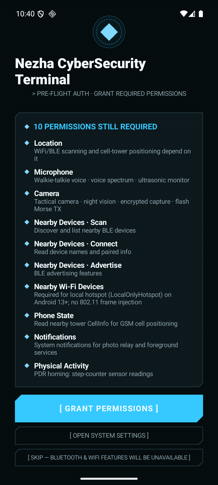
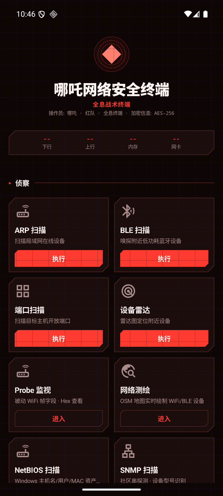
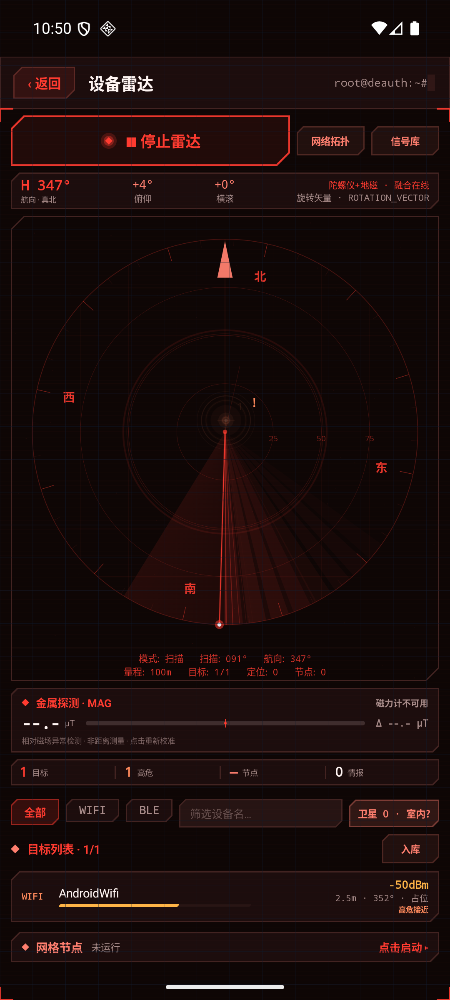
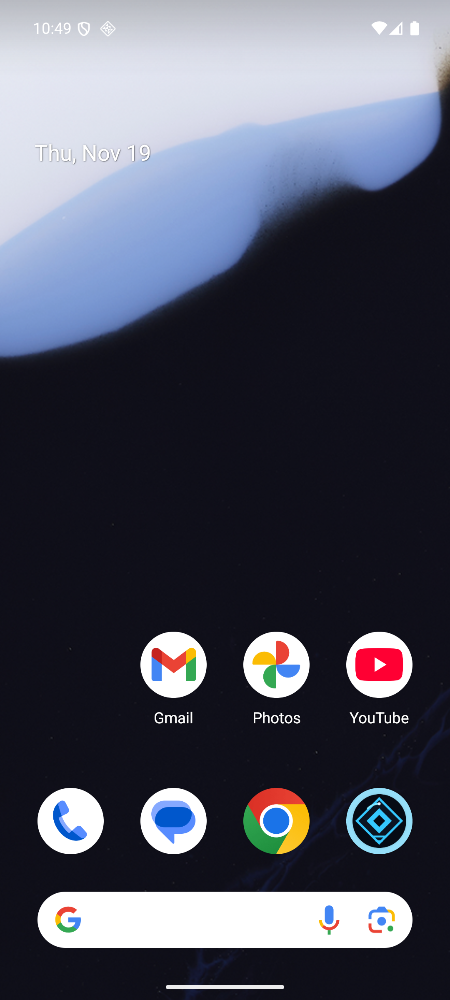
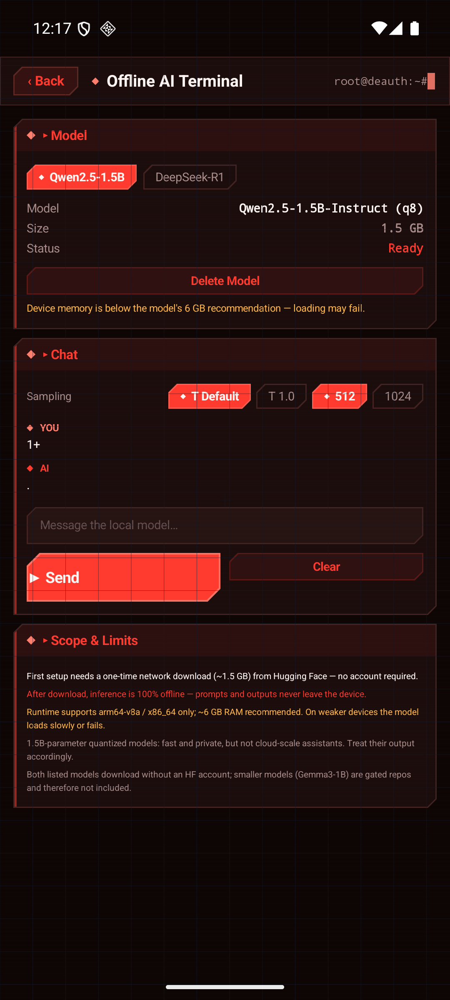

<!-- ═══════════════════════════════════════════════════════════════
     DeauthCtrl · 哪吒网络安全战术终端
     钟智强 · ctkqiang — 中国红客 × 赛博朋克
     "不认命，就是我的命"
═══════════════════════════════════════════════════════════════ -->

```
          ◆
        ◇ ◇ ◇                DEAUTHCTRL
      ◇   ◆   ◇          哪吒网络安全战术终端
        ◇ ◇ ◇
          ◆
```

# DeauthCtrl · 哪吒网络安全战术终端

<p align="center">
  
  
  
  
  
  
  
  <a href="https://github.com/ctkqiang/DeauthCtrl/stargazers"></a>
</p>

<p align="center">
  <b>一台握在手里的全息战术终端。</b><br/>
  61 个战术模块 · 39 支队伍主题 · 全息 HUD 界面 · 桌面图标随主题换色 · 本地大模型离线对话<br/>
  纯 Kotlin 软件实现 · 中英双语开箱即用 · 好莱坞级交互细节<br/>
  <i>不认命，就是我的命。</i>
</p>

---

## ⚠ 法律声明

> **本工具仅供授权安全研究与教育用途，请负责任地使用。**

| 事项 | 说明 |
| ---- | ---- |
| 授权边界 | 攻击非自有设备或网络属于**违法行为**；请仅在您拥有或已获书面授权的环境中测试 |
| 无线电合规 | BLE / WiFi 广播可能违反当地无线电管理条例 |
| 责任 | **开发者不对任何滥用行为承担责任**；使用本工具即表示您已充分理解并承诺合规使用 |

**真实能力清单 —— 界面不夸大平台做不到的事：**

| 模块 | 真实能力 | 不做的事 |
| ---- | -------- | -------- |
| 本机热点 / SSID 轮换 | 创建**本机** SoftAP 热点、轮换本机热点 SSID | 不发送 deauth / beacon 帧注入，不干扰他人连接 |
| BLE 广播 | 广播伪造厂商广告包，可能让附近设备显示配对或连续性提示 | 不能压制、不能断开设备；效果取决于接收端系统 |
| 蓝牙广播与发现 | 本机扫描附近经典蓝牙设备 | 不干扰其他设备 |
| 802.11 帧注入 | 需要 root + 特定芯片与固件 | 运行时检测能力，不支持时明确提示，不提供假象 |
| 流量监视 | VpnService 本机抓包 + Wireshark 式解析 | 只抓本机流量 |

---

## 下载

[](https://github.com/ctkqiang/DeauthCtrl/releases/latest)

前往 [GitHub Releases](https://github.com/ctkqiang/DeauthCtrl/releases/latest) 获取最新自动构建发布的通用独立安装包（`DeauthCtrl-universal-sideload.apk`）。

---

## 界面

<p align="center">
<table>
<tr>
<td align="center"><b>主页 · 蓝队全息青</b><br/></td>
<td align="center"><b>主页 · 红队猩红</b><br/></td>
<td align="center"><b>全息切片转场</b><br/></td>
</tr>
</table>
</p>

切一支队伍 = 整机换装：全局配色、主页全息核心、标题流光、扫描掠光，**连桌面启动图标都同步换色**。

<p align="center">
  
</p>

---

## 为什么是它

面向授权安全研究、无线协议实验与应急场景的 **Android 战术工具集**。以一台手机为平台，用纯软件实现从侦察、无线、网络到工具链的完整战术面，外加一台**真正跑在本机上的大模型**。

- **全息 HUD** —— 96dp 多环动态核心、标题流光、全屏扫描掠光、切片展开转场，每一帧都像战术投影
- **桌面图标随主题换色** —— 13 个图标变体经 activity-alias 切换，换队即换装，连启动器都不放过
- **离线 AI 终端** —— Qwen2.5-1.5B / DeepSeek-R1 量化模型跑在 LiteRT-LM 上，下载一次，推理永久离线，提示词不出设备
- **诚实的能力边界** —— 界面上写明的能力就是平台真实能力，做不到的（deauth 帧注入等）明确说做不到

> 追求对底层机制的极致掌控——从手写 DNS 报文，到 `BluetoothLeAdvertiser` 伪造厂商广播，再到 VpnService 逐包解析与本地大模型推理。

---

## 61 个战术模块 · 6 大战区

| 侦察 RECON | 无线 WIRELESS | 工具 TOOLS | 态势 SITUATIONAL | 实验室 LAB | 网络 NETWORK |
| ---------- | ------------- | ---------- | ---------------- | ---------- | ------------ |
| ARP 扫描 | BLE 广播 | 对讲机 | 卫星天图 | 网格聊天 | WEB 服务 |
| BLE 扫描 | 本机热点 | 文件快传 | 步测归航 | 声呐测距 | HTTP 请求 |
| 端口扫描 | 蓝牙广播与发现 | 屏幕镜像 | 电线探测 | 信道占用 | 目录爆破 |
| 设备雷达 | 热点 SSID 轮换 | 加密保险箱 | 声波传讯 | 震动监视 | PING 泛洪 |
| 网络测绘 | 红外遥控 | Payload 生成 | 硬件自检 | 逻辑示波 | 流量监视 |
| CVE 搜索 | NFC 工作台 | 反弹 Shell | 全息水平仪 | 万能遥控 | DNS 工坊 |
| 语音频谱 | BLE GATT | SSH 客户端 | — | 局域网工具 | Whois 查询 |
| 战术相机 | Nordic 工作台 | 本地终端 | — | — | TLS 证书检查 |
| 基站监视 | — | 摩尔斯码 | — | — | — |
| Probe 监视 | — | 串口监视 | — | — | — |
| 数字夜视 | — | 有线探测 | — | — | — |
| 战术地图 | — | 数据库 | — | — | — |
| mDNS 发现 | — | 局域网会议 | — | — | — |
| — | — | NetBIOS 扫描 | — | — | — |
| — | — | SNMP 扫描 | — | — | — |
| — | — | 哈希工坊 | — | — | — |
| — | — | 二维码工坊 | — | — | — |
| — | — | 密码生成器 | — | — | — |
| — | — | **离线 AI 终端** | — | — | — |

### 离线 AI 终端 —— 本机上的大模型

| 项 | 值 |
| -- | -- |
| 模型 | Qwen2.5-1.5B-Instruct（q8，默认）· DeepSeek-R1-Distill-Qwen-1.5B —— 均无需 HF 账号即可下载 |
| 运行时 | LiteRT-LM（litertlm-android 0.11.0） |
| 体积 | 约 1.5 GB · 首次联网下载一次 |
| 隐私 | 下载后推理 **100% 离线**，提示词与输出不出设备 |
| 设备 | arm64-v8a / x86_64 · 建议约 6GB 内存 |
| 能力 | 多轮对话、流式输出、采样参数（温度 / maxTokens）可调、随时中断与清空 |

<p align="center">
  
</p>

> 实机实测:模拟器上完整跑通「下载模型 → 引擎加载 → 本机推理」全链路,Qwen2.5-1.5B 对 `1+` 流式回答 `2.`。更小的 Gemma3-1B 因仓库受限需 HF 令牌,未收录。

### 新增战术工具

| 模块 | 能力 | 实现 |
| ---- | ---- | ---- |
| DNS 工坊 | A/AAAA/CNAME/MX/TXT/NS/SOA/PTR 记录查询 | 手写 RFC 1035 报文 · UDP 53 |
| mDNS 发现 | 局域网 Bonjour/Avahi 服务浏览 | 组播 224.0.0.251:5353 |
| TLS 证书检查 | 证书链 / 指纹 / 有效期 / 主机名体检 | SSLSocket + SNI |
| Whois 查询 | 注册局数据直查 | TCP 43 + 内置服务器表 |
| 哈希工坊 | 文本与文件的 SHA-256 / SHA-1 / MD5 | 64KB 分块流式 |
| 二维码工坊 | 文本 / URL / WiFi / 名片二维码 | zxing 本地渲染 |
| 密码生成器 | 高熵密码 + 熵值评估 | SecureRandom |
| 全息水平仪 | 气泡盘面 + 横滚/俯仰角 | 重力矢量低通滤波 |

---

## 队伍主题系统

内置 **39 支队伍**，每支队伍是一套从单一基准色 HSV 派生的完整色板（背景 / 面板 / 边框 / 文字 / 告警 / 电光）：

- 切换即时生效：`key(teamId)` 强制全树重组，所有页面、组件、动画零改动整体换色
- **桌面启动图标同步换色**：13 个图标变体（灰 + 12 色相）经 `activity-alias` 暴露，按队伍主色相自动启用最近变体
- 低饱和主题（极地白 / 钛银 / 光子白）自动落到灰变体

```
设置 → 队伍与主题 → 点选色板 → 全界面 + 桌面图标即时换装
```

---

## UI 设计系统

视觉语言：**全息青蓝 + 深海军蓝**。斜切角面板、细发光边框、扫描环与数据流。对比度纪律：正文对比度 ≥ 4.5:1，告警一律走 Danger 色。

| 元素 | 效果 |
| ---- | ---- |
| 全息核心 | 96dp 多环动态核心：脉冲外辉光 + 涟漪扩散 + 60 刻度慢旋环 + 反向虚线内环 + 辉光菱形 |
| 标题流光 | 金色高光带每 2.8 秒扫过应用标题 |
| 扫描掠光 | 每 4.2 秒一道主色光带自上而下扫过主页，像雷达全屏扫描 |
| 切片转场 | 页面导航自屏幕中线向上下**切片展开 + 收拢退场**，切换瞬间整屏主色短闪 |
| 运行锁定 | 运行中的模块 = 被锁定的目标：呼吸边框 + 四角括号 + 菱形脉冲，同一相位 |
| 启动自检 | 真实系统自检逐行浮现：授权 / 链路 / 内存 / 版本，失败项用危险色 |

**动画纪律**：所有高频动画（呼吸 / 旋转 / 扫描）只读**绘制层状态**，零逐帧重组；雷达盘面静态层用 `drawWithCache` 缓存几何，动态层每帧只画光束与目标。

---

## 技术架构

```
┌────────────────────────────────────────────────────────────┐
│                 UI Layer (Jetpack Compose)                 │
│  61 Modules · Holographic HUD · Team Theme System          │
│  HoloCore · GlitchText · ScanlineOverlay · TacticalCorners │
├────────────────────────────────────────────────────────────┤
│            ViewModel Layer (StateFlow + Haptic)            │
│  40+ ViewModels: Radar · Walkie · Terminal · Gsm · AI …    │
├────────────────────────────────────────────────────────────┤
│               Manager Layer (Business Logic)               │
│  Android APIs · ServerSocket · JSch SSH · OpenCV ·         │
│  VpnService 抓包 · Termux 终端引擎 · osmdroid 地图 ·        │
│  LiteRT-LM 本地大模型 · 手写 DNS/mDNS 报文                  │
├────────────────────────────────────────────────────────────┤
│                 Model Layer (Data Classes)                 │
│  RadarTarget · WifiNetwork · WalkiePeer · GnssSat ·        │
│  DeviceIntel · ScanState · MirroringDevice …               │
└────────────────────────────────────────────────────────────┘
```

| 层级 | 技术 | 版本 |
| ---- | ---- | ---- |
| 语言 | Kotlin | 2.2.0 |
| UI | Jetpack Compose + Material 3 | BOM 2024.09.00 |
| 架构 | MVVM + Manager Pattern | — |
| 状态 | StateFlow + AndroidViewModel | 2.8.6 |
| 异步 | Kotlin Coroutines | 1.9.0 |
| 本地大模型 | LiteRT-LM (Qwen2.5-1.5B q8) | 0.11.0 |
| 终端 | Termux 终端引擎 (vendor) | 0.118.3 |
| SSH | JSch (mwiede) | 0.2.20 |
| 视觉 | OpenCV · osmdroid · zxing · compose-charts | 4.9.0 / 6.1.20 / 4.3.0 / 0.1.0 |
| 最低 SDK | Android 6.0 | API 23 |
| 目标 SDK | Android 9 | API 28 |
| 构建 | Gradle + AGP · JDK 17 | 8.13 |

---

## 中英双语

| 机制 | 行为 |
| ---- | ---- |
| 跟随系统 | 默认策略：中文设备显示中文，英文设备显示英文 |
| 应用内切换 | 设置 → 语言：系统 / 中文 / English，立即重建界面并持久化 |
| 技术缩写 | BSSID / RSSI / SNR / TAC / 协议名 / 单位保持原文 |

- 语言偏好持久化于 `deauthctrl_prefs`（`app_language` = `system` / `zh` / `en`）
- 字符串按模块分片维护（`strings_<模块>.xml`），新增模块自带独立资源文件，互不冲突

---

## 权限需求

| 权限 | 用途 | 运行时 |
| ---- | ---- | ------ |
| `BLUETOOTH_SCAN` / `CONNECT` / `ADVERTISE` | BLE 扫描 / 连接 / 广播 | ✓ |
| `ACCESS_FINE_LOCATION` | BLE/WiFi 扫描与基站定位 | ✓ |
| `NEARBY_WIFI_DEVICES` | 本机热点 (LocalOnlyHotspot) | ✓ |
| `RECORD_AUDIO` | 对讲机语音 · 声波传讯 · 语音频谱 | ✓ |
| `CAMERA` | 战术相机 · 数字夜视 · 闪光摩尔斯 | ✓ |
| `POST_NOTIFICATIONS` | 照片中继与前台服务通知 | ✓ |
| `ACTIVITY_RECOGNITION` | 步测归航步数传感器 | ✓ |
| `VIBRATE` / `NFC` / `USB` | 触觉反馈 · NFC 工作台 · OTG 串口 | — |

---

## 构建指南

| 工具 | 版本 |
| ---- | ---- |
| Android Studio | Hedgehog+ |
| JDK | 17+ |
| Android SDK | 34 |
| 真机 | Android 6.0+（BLE / 对讲 / 本地大模型需真机） |

```bash
git clone https://github.com/ctkqiang/DeauthCtrl.git
cd DeauthCtrl

./gradlew installDebug       # 安装调试版
./gradlew assembleRelease    # 构建发布版 APK
```

---

## 开发者

| 项目 | 信息 |
| ---- | ---- |
| 作者 | 钟智强 (ctkqiang) |
| 代号 | 哪吒网络安全 |
| 邮箱 | ctkqiang@dingtalk.com |
| 仓库 | github.com/ctkqiang/DeauthCtrl · gitcode.com/ctkqiang_sr/DeauthCtrl |
| 架构 | MVVM + StateFlow + Jetpack Compose |
| 语言 | 中文 / English（设置内可切换） |

---

> **中国红客 · 国产自主 · 安全可控**

---

如果您觉得本项目对您有帮助，欢迎请我喝杯咖啡，您的支持是我持续维护和改进的动力！

<p align="center">
  <strong>微信扫码捐赠</strong><br/>
  
</p>
